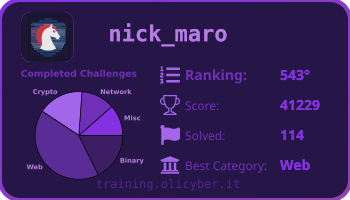

<div align="center">

# OliCyber Cards · Themes

**Your CTF progress, at a glance. Six SVG themes for your GitHub profile.**

[](https://github.com/Nick-Maro/ocbadge_themes/actions/workflows/test.yml)




The bundled preview uses fictional sample data, not a real player profile.

[Try a sample](#try-it-without-an-account) · [Automate your card](#keep-your-card-up-to-date) · [Choose a theme](#choose-your-theme)

</div>

Turn your [OliCyber training-platform](https://training.olicyber.it/) stats into a card you can embed in a README: ranking, score, solved challenges and strongest category. Chart themes also show your solves by category.

This is Nick-Maro's theme-focused fork of [utcq/ocbadge](https://github.com/utcq/ocbadge). It adds visual styles while keeping the original idea: generate a static image in your own repository, with no badge server to host.

## Try it without an account

Requires **Python 3.11 or newer**. The sample uses fictional data, makes no network requests and needs no token.

```sh
git clone https://github.com/Nick-Maro/ocbadge_themes.git
cd ocbadge_themes
python -m venv .venv
```

Activate the environment:

```sh
# macOS / Linux
source .venv/bin/activate
```

```powershell
# Windows PowerShell
.\.venv\Scripts\Activate.ps1
```

Then install and render:

```sh
python -m pip install -r requirements.txt
python gen.py hacker --sample --output output/sample.svg
```

Open `output/sample.svg` in a browser. Try `default`, `dark` or `white` to see the category chart.

## Choose your theme

| Style | Look | Category chart |
| --- | --- | --- |
| `default` | Purple neon | Yes |
| `dark` | Deep purple | Yes |
| `white` | Light lavender | Yes |
| `darkRed` | Red accents | No |
| `hacker` | Green terminal | No |
| `oldDefault` | Original card layout | No |

Style names are case-sensitive. A misspelled style produces an error before contacting the API.

## Generate your own card locally

1. Sign in at [training.olicyber.it](https://training.olicyber.it/).
2. Open browser developer tools, then **Application / Storage → Local Storage → training.olicyber.it**.
3. Copy your account token. Treat it as a password: use it only on a machine or repository you control.

Set it for the current shell:

```sh
# macOS / Linux: paste your token when prompted, without recording it in history
read -rsp 'OliCyber token: ' OC_TOKEN; echo
export OC_TOKEN
python gen.py dark
unset OC_TOKEN
```

```powershell
# Windows PowerShell / PowerShell 7: keep the token out of command history
$tokenInput = Read-Host 'OliCyber token' -AsSecureString
$env:OC_TOKEN = [System.Net.NetworkCredential]::new('', $tokenInput).Password
python gen.py dark
Remove-Item Env:OC_TOKEN
Remove-Variable tokenInput
```

The default destination is `card.svg` in your current directory. Template assets are located relative to the script, so you can run it from another directory too.

```sh
python gen.py white --output output/profile.svg
python gen.py hacker --data-output output/stats.json
python gen.py --help
```

JSON export is optional and contains only the displayed public stats. The token, full name and raw API responses are never written by the generator. Your nickname and stats are visible to anyone who can view a published card.

## Keep your card up to date

1. Fork this repository to your own account.
2. In your fork, enable **Actions** if GitHub asks.
3. Go to **Settings → Secrets and variables → Actions → Secrets** and add a repository secret named **`OC_TOKEN`**.
4. Under **Variables**, optionally add **`OC_STYLE`** with one of the six style names. This is the default for scheduled runs; it falls back to `default`.
5. Open **Actions → Generate Card → Run workflow**. Choose a style and run it.

The workflow generates `card.svg` and commits it to the selected branch only when its contents change. It also runs daily at **23:23 UTC**; scheduled GitHub Actions can be delayed. The cron schedule does not follow daylight saving time. A manual style choice affects that run; set `OC_STYLE` to make a choice persist for scheduled runs.

Only the generation job gets repository write permission. Tokens and style choices enter the shell through environment variables, and an API failure leaves the existing card in place.

### Embed it in your profile

Replace `YOUR_USER`, `YOUR_REPO` and, if needed, the branch name:

```markdown

```

GitHub may cache profile images, so a fresh workflow run may take time to appear in a README.

## Troubleshooting

| Symptom | What to check |
| --- | --- |
| `Set OC_TOKEN ...` | Set the environment variable locally, or add the repository secret in your fork. Use `--sample` to try the renderer offline. |
| `OliCyber rejected OC_TOKEN` | Sign in again, retrieve the current token and replace your local value or repository secret. |
| Ranking is `N/A` | The API scoreboard did not include an exact match for your displayed name. Other stats can still render. |
| Empty chart / best category is `N/A` | Accounts with no solves are supported; there is no category distribution yet. |
| Network / HTTP / invalid JSON error | Retry later. The script checks HTTP responses and uses bounded connection/read timeouts. |
| Actions cannot update `card.svg` | Check repository or organization rules. The generation job needs permission to write contents, and branch protection may forbid direct commits. |

This project depends on the training platform's API response format. It is an independent community project, not an official OliCyber service.

## Develop and contribute

```sh
python -m unittest discover -s tests -v
node --test tests/workflow.test.js
```

Tests run offline and cover all six templates, new accounts with zero solves, unranked players, SVG text escaping, token errors, HTTP failures, deterministic output and running from another directory. The workflow tests use Node.js 18+ and simulate GitHub responses without writing to GitHub. CI runs the checks on Python 3.11 and 3.13.

The main pieces are:

| Path | Purpose |
| --- | --- |
| `gen.py` | API client, stat summary, SVG renderer and CLI |
| `data/template_*.svg` | Theme templates; braces used as literal text must be doubled |
| `examples/sample-player.json` | Fictional data for offline previews |
| `tests/` | Regression tests without account credentials |
| `.github/workflows/generate-card.yml` | Manual and daily card generation |

To propose a theme, start from an existing SVG, add its name and optional chart palette to `TEMPLATE_COLOR_PALETTES`, then update the workflow dropdown and theme table. Run the offline tests and include a sample render in your pull request.

## Credits and reuse

Original generator: [utcq/ocbadge](https://github.com/utcq/ocbadge). Theme fork: [Nick-Maro/ocbadge_themes](https://github.com/Nick-Maro/ocbadge_themes). OliCyber names, logos and platform data belong to their respective owners.

The inherited repository does not declare a license. This fork preserves that status; no new license or permission to redistribute third-party assets is implied. Clarifying the upstream license is a prerequisite for offering broader reuse permissions.
